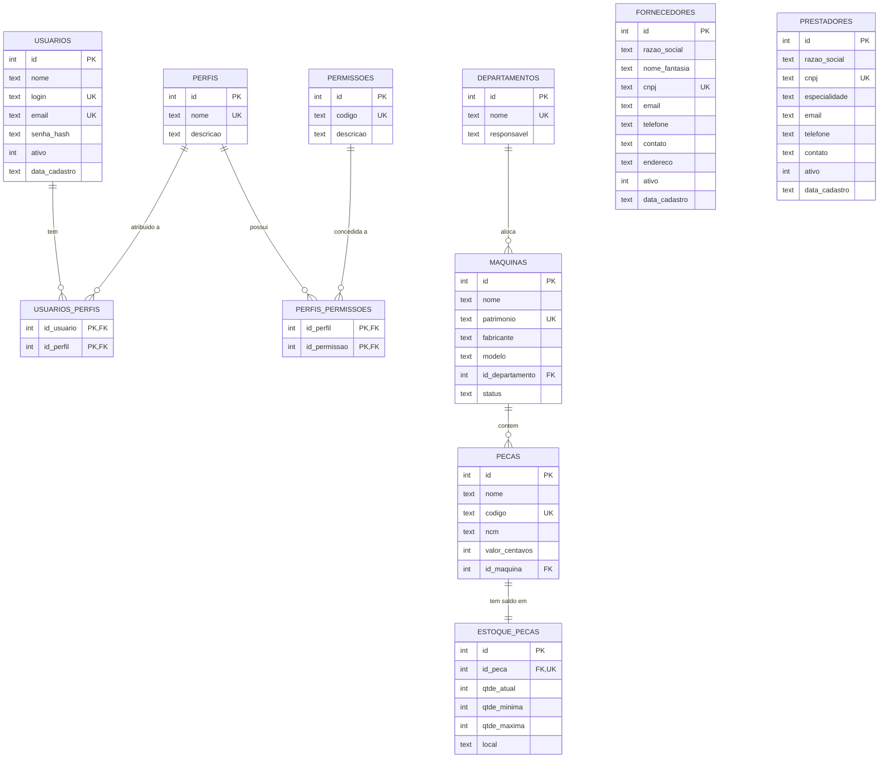

# Modelo de dados (Sprint 2)

**Tarefas:** SB-103 (máquinas e departamentos) · SB-105 (peças e estoque) ·
SB-107 (fornecedores) · SB-109 (prestadores de serviço) · SB-102 (usuários e RBAC)

A modelagem está em código no arquivo [`schema.sql`](../schema.sql). O
`database.py` executa esse arquivo sempre que o app sobe, e o `IF NOT EXISTS`
garante que nada seja apagado.

## Diagrama entidade-relacionamento

Fornecedores e prestadores ainda não têm relacionamento: eles ganham ligações
na Sprint 3 (fornecedor → notas fiscais; prestador → serviços da OS).

## Cardinalidades

| Relacionamento | Cardinalidade | Como o banco garante |
|---|---|---|
| usuários × perfis | N:N | Tabela de junção `usuarios_perfis` com chave primária composta |
| perfis × permissões | N:N | Tabela de junção `perfis_permissoes` com chave primária composta |
| departamentos → máquinas | 1:N | `maquinas.id_departamento NOT NULL`, FK com `ON DELETE RESTRICT` |
| máquinas → peças | 1:N | `pecas.id_maquina NOT NULL`, FK com `ON DELETE RESTRICT` |
| peças → estoque | 1:1 | `estoque_pecas.id_peca UNIQUE`, FK com `ON DELETE CASCADE` |

## Convenções

- Chave primária sempre `id`; chave estrangeira `id_<tabela no singular>`.
- Nomes em português, minúsculos, com `_` (snake_case).
- **Dinheiro em centavos**, em `INTEGER` (`valor_centavos`). Nunca `REAL`, porque float erra
  arredondamento (0,1 + 0,2 = 0,30000000000000004).
- Booleano como `INTEGER` 0/1 com `CHECK (ativo IN (0, 1))`.
- Status gravado como código (`OPERANDO`, `EM_MANUTENCAO`, `PARADO`), com `CHECK`
  no banco e o texto de exibição no Python (`modulos/maquinas/dados.py`).
- `COLLATE NOCASE` em login, e-mail, nome de departamento, patrimônio e código:
  "Produção" e "PRODUÇÃO" contam como repetidos.
- `PRAGMA foreign_keys = ON` em toda conexão (no SQLite ela vem desligada).

## Regras de integridade

| Regra | Onde fica |
|---|---|
| Não apagar departamento que tem máquina | FK `RESTRICT` + mensagem amigável na rota |
| Não apagar máquina que tem peça | FK `RESTRICT` + mensagem amigável na rota |
| Peça e estoque nascem juntos | Transação em `modulos/pecas/dados.py` (`with conexao:`) |
| Estoque nunca negativo | `CHECK (qtde_atual >= 0)` e `CHECK (qtde_minima >= 0)` |
| Máximo ≥ mínimo | `CHECK (qtde_maxima >= qtde_minima)` + validação na rota |
| Saldo só muda por movimentação | A tela de edição não altera `qtde_atual` (a movimentação entra na Sprint 3) |
| CNPJ com 14 dígitos, único e válido | `CHECK (length(cnpj) = 14)`, `UNIQUE` + dígitos verificadores em `validadores.py` |
| Fornecedor, prestador e usuário não são apagados | Exclusão lógica (`ativo = 0`) |
| Senha nunca em texto puro | Só `senha_hash` (Werkzeug `generate_password_hash`) |
| Sistema nunca fica sem administrador | Regra em `modulos/usuarios/rotas.py` |

Toda regra importante fica **nos dois lugares**: na rota (para dar uma
mensagem clara) e no banco (para garantir mesmo se o código falhar). Os testes
em `tests/test_cadastros.py` conferem as duas camadas.

## Estoque: situação calculada

A situação não é gravada; o SQL calcula a cada consulta (`modulos/pecas/dados.py`):

| Situação | Condição | Na tela |
|---|---|---|
| `REPOR` | `qtde_atual < qtde_minima` | Linha destacada, etiqueta "⚠ Repor" e "comprar N" (N = máximo − atual) |
| `EXCESSO` | `qtde_atual > qtde_maxima` | Etiqueta amarela "Excesso" |
| `OK` | entre o mínimo e o máximo | Etiqueta verde "Normal" |
